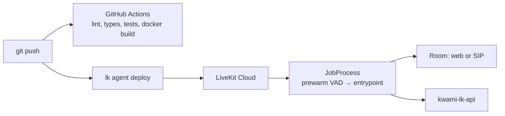

# Deployment

The agent ships as a Docker image. There are two supported places to run it:

| Target | Path | Use it when |
| --- | --- | --- |
| **LiveKit Cloud** (default) | `agent/` + `lk agent deploy` | You want LiveKit to own scaling, placement and restarts. |
| **Cloudflare Workers + Containers** | `infra/` + `make deploy-cf` | You want the agent next to the rest of your Cloudflare estate, or a Worker-fronted health surface. |

Both run the same image and the same `src.main start` entrypoint. Production
answers to one agent name: `kwami-agent` (`livekit.toml` + `@server.rtc_session`,
overridable with `KWAMI_AGENT_NAME`).



## First-time create

```bash
cd agent
lk agent create .     # or: make create
```

This registers the agent with your LiveKit Cloud project. `livekit.toml`
stores the project subdomain and agent id.

## Deploy

```bash
make deploy           # cd agent && lk agent deploy
```

LiveKit Cloud builds from `agent/Dockerfile` (or uses the image it builds on
their side from the same context). CI already `docker build`s that context on
every PR so a broken image is caught before you deploy.

## Testing without touching production

LiveKit dispatches a job to **any** registered worker whose agent name matches
the one in the token's `RoomAgentDispatch`. That has two consequences worth
knowing before you test anything:

- **A local worker with the production name takes production calls.** Running
  `python -m src.main dev` with the default name registers a second
  `kwami-agent` next to the cloud one, and real users' sessions land on your
  laptop at random. Give local and test workers their own name:

  ```bash
  KWAMI_AGENT_NAME=kwami-agent-lab uv run python -m src.main dev
  ```

  and dispatch to it explicitly (`RoomAgentDispatch(agent_name="kwami-agent-lab")`
  from a test client, or `LIVEKIT_AGENT_NAME=kwami-agent-lab` on a local API).
- **Deployments of one agent share it.** `lk agent deploy -d <deployment>`
  targets a deployment of the agent in `livekit.toml`; deploying a second
  deployment of the same agent has restarted the production worker. For a
  long-lived test environment, create a separate agent (`lk agent create` from a
  copy of `livekit.toml` with another `name`, e.g. `kwami-agent-pruebas`), set
  `KWAMI_AGENT_NAME` to that name in its secrets, and point the test API's
  `LIVEKIT_AGENT_NAME` at it.

Before deploying production, check what is live (`lk agent versions` shows each
version's `git_commit`) so a deploy from another branch does not silently drop
someone else's change; `lk agent rollback` returns to the previous version.

## Image

`agent/Dockerfile`:

- Base: `ghcr.io/astral-sh/uv:python3.13-bookworm-slim`
- `uv sync --locked` from `pyproject.toml` + `uv.lock`
- Non-root `appuser` (UID 10001)
- `python -m src.main download-files` at build time (VAD / plugin assets)
- CMD: `uv run python -m src.main start`

Local Python is 3.11; production is 3.13. Both must stay green in CI.

## Secrets on LiveKit Cloud

Configure the same variables as `.env.sample` in the Cloud agent secrets UI
(or whatever `lk` currently documents). Minimum production set:

- `LIVEKIT_URL`, `LIVEKIT_API_KEY`, `LIVEKIT_API_SECRET` (usually injected)
- `OPENAI_API_KEY`, `DEEPGRAM_API_KEY`, plus any other providers you advertise
- `KWAMI_PROVIDER_KEYS_SECRET`, the same Fernet key as the API's
  `PROVIDER_KEYS_SECRET`, to use the model keys users connect from the app
- `KWAMI_API_URL` — **not** `localhost`. Use the public API origin.
- `KWAMI_API_KEY` — must match the API
- Optional: `ZEP_API_KEY`, `TAVILY_API_KEY`, `SERPAPI_KEY`, `BROWSERBASE_API_KEY` + `BROWSERBASE_PROJECT_ID` (default browser vendor), `BROWSER_USE_API_KEY`

Leave `KWAMI_ALLOW_BROWSER_JS` unset unless you accept the
[prompt-injection risk](./security.md).

## The brain's cloud work thread

With `KWAMI_CLOUD_WORKER=true` the worker process also runs the brain's cloud
work thread (`agent/src/brain/cloud.py`), started once when LiveKit registers
the worker. It takes, from `brain_jobs`, the work of every user who allowed the
cloud from the app: what they asked the cloud for, and `auto` work their PC has
not been there for (migration 029 of the API, `brain_claim_cloud_job`).

Before turning it on:

1. The database has migration 029. Without it the thread finds nothing to take.
2. Decide who it may spend for. Each job runs on the user's own Anthropic key,
   connected from the app (needs `KWAMI_PROVIDER_KEYS_SECRET`), or on this
   deployment's `ANTHROPIC_API_KEY` for the user ids in `KWAMI_CLOUD_OWNERS`.
   Everyone else is told to connect a key. The monthly cap and the 2 $ per task
   apply as on the PC.
3. The image has `git`: changes to Jarvis's own code start from an anonymous,
   read-only clone of `KWAMI_CLOUD_REPO_OWNER`'s repositories (public ones only)
   and are left as a patch for the user's PC, which runs the tests and opens the
   pull request. The cloud never holds GitHub credentials.

What a job makes is kept in `jarvis-files/<user>/<kwami>/threads/<thread>` and
listed in `brain_sync`; the PC copies it home the next time it is on. The same
thread can run on any host with `uv run python -m src.brain.cloud`.

## Telephony

SIP participants do not send a frontend `config`. The worker:

1. Reads `kwami_id` from job metadata, participant metadata, or attributes
2. Starts `GET /internal/kwamis/{id}/runtime` **before** `session.start()`
3. Applies the JSON as a full config after the room is up

The fetch goes to `KWAMI_RUNTIME_API_URL` when that is set, otherwise to
`KWAMI_API_URL`. If it fails, the placeholder agent stays on the call. Set
`KWAMI_API_TIMEOUT` as low as you can tolerate; callers hear the default
persona until it returns.

## Scaling and lifecycle

LiveKit Cloud owns concurrency, placement, and process restart. This repo
does not include Kubernetes manifests. Each job:

- Prewarms Silero VAD on the process
- Registers `state.cleanup` as a shutdown callback (~10s budget)
- Reports usage last so billing cannot starve browser teardown

See [Billing](./billing.md) and [Architecture](./architecture.md).

## Cloudflare Workers + Containers

`infra/` runs the same agent image inside a Cloudflare Container, fronted by a
Worker. A LiveKit worker must stay registered with LiveKit Cloud, so the
container is kept alive deliberately rather than being allowed to sleep.

```bash
make install          # also installs infra/ deps via pnpm
make deploy-cf         # production   (wrangler deploy --env "")
make deploy-cf-staging # staging      (wrangler deploy --env staging)
```

### How it stays up

- `sleepAfter = "24h"` and `onActivityExpired()` calls `renewActivityTimeout()`
  instead of the default stop, so an idle-but-registered worker is not reaped.
- A cron trigger (`*/2 * * * *`) calls `ensureRunning()` as a keep-alive.
- `ensureRunning()` is wrapped in `blockConcurrencyWhile`, so simultaneous
  requests cannot race two container starts.

### Worker routes

| Route | Method | Meaning |
| --- | --- | --- |
| `/health`, `/status` | GET | Starts the container if needed, then proxies the container's own `/health`. |
| `/start` | POST | Starts the container and returns its state. |
| `/`, `/ready` | GET | Service, environment and container state. |

`/health` returns `503` with `status: "degraded"` when the Worker is reachable
but the container is not — the Worker being up is still useful information, so
it is not reported as a flat `error`. **Cloudflare Containers requires the
Workers Paid plan**; on a free account the health route returns `degraded` with
a `hint` naming that as the cause.

### The Worker's control endpoints

`POST /start` boots a container and requires `Authorization: Bearer
$KWAMI_ADMIN_TOKEN`. It **fails closed**: with no `KWAMI_ADMIN_TOKEN` secret
set, the route answers 401 regardless. That is deliberate — `/health` and the
two-minute keepalive cron already start the container on their own, so `/start`
is an operator convenience, and the Worker is published to `*.workers.dev` with
preview URLs enabled, so an unauthenticated route that starts paid compute is
reachable by anyone who finds the hostname.

```bash
cd infra && pnpm secrets:bulk secrets.json   # includes KWAMI_ADMIN_TOKEN
curl -X POST https://<worker>/start -H "Authorization: Bearer $KWAMI_ADMIN_TOKEN"
```

`/health`, `/status`, `/` and `/ready` stay unauthenticated — the Containers
runtime uses `/health` as its `pingEndpoint`. They report status only; the raw
runtime error text goes to the Worker log, not to the response.

### Staging shares production's LiveKit project and API

`make deploy-cf-staging` currently deploys a separate Worker
(`kwami-lk-agent-staging`) that connects to the **production** LiveKit project
and the **production** Kwami API. Sessions it serves are real sessions and the
credits they consume are real credits.

The `staging` block in `infra/wrangler.jsonc` carries a `FIXME(staging)` with
what has to change. Until it does, treat a staging deploy as a production one.

### Google credentials on Cloudflare

`GOOGLE_APPLICATION_CREDENTIALS` is a path to a service-account JSON file, and
no such file exists in the container image — forwarding the variable would
point the Google SDK at something that is not there, so the Worker deliberately
does not forward it (see `infra/src/env.ts`). Use `GOOGLE_API_KEY` on this
target. `tests/unit/test_worker_env_parity.py` allowlists it explicitly, with
this reason, so it cannot be "fixed" by adding it back.

### Configuration and secrets

Non-secret values live in `wrangler.jsonc` under `vars` (`ENVIRONMENT`,
`LIVEKIT_URL`, `KWAMI_API_URL`, `KWAMI_RUNTIME_API_URL`, `KWAMI_API_TIMEOUT`, `KWAMI_ALLOW_BROWSER_JS`, and the browser, logging, tracing and cloud-worker settings; see the file).
Provider credentials are Worker secrets, forwarded into the container by
`containerEnvFromWorker()` in `infra/src/env.ts`:

```bash
cp infra/secrets.example.json infra/secrets.json   # gitignored
# edit, then:
cd infra && pnpm secrets:bulk secrets.json
```

`infra/secrets.json` and `infra/.dev.vars` are gitignored and must stay that
way. `worker-configuration.d.ts` is generated by `pnpm types` from
`wrangler.jsonc` and is also gitignored — run it after editing bindings or vars,
or `tsc` will not see them.

### pnpm settings

pnpm 11 reads only auth and registry keys from `.npmrc`; everything else belongs
in `infra/pnpm-workspace.yaml`. Two settings there are load-bearing:

- `allowBuilds` for `esbuild` and `workerd` — both fetch prebuilt binaries in a
  postinstall script. Without approval the scripts are skipped and
  `wrangler dev` / `wrangler deploy` have no runtime.
- `minimumReleaseAgeExclude` for the Cloudflare toolchain — pnpm 11 defaults
  `minimumReleaseAge` to 24h, which would otherwise refuse a freshly published
  pinned `wrangler`.

`pnpm check` runs `wrangler deploy --dry-run`: it bundles the Worker, validates
every binding and migration, and builds the container image, all without
credentials. It is the closest thing to a real deploy and runs on every release
tag. `infra/container/Dockerfile` intentionally mirrors `agent/Dockerfile` —
keep the install and prewarm steps aligned when you change either.

## CI as a deploy gate

The `docker` job in `.github/workflows/test.yml` builds `context: agent`
without pushing. Treat a red Docker job as "do not deploy".

The `infra` job in the same workflow runs `wrangler types` then `tsc --noEmit`
over `infra/src/`, so a Worker that cannot compile is caught before
`make deploy-cf`.

Nightly e2e (`.github/workflows/e2e.yml`) is information, not a merge blocker.
A failure after merge to `main` means a provider or a live path broke.

## Versioning

`agent/pyproject.toml` carries the version; it is `1.0.0`. Releases are
documented in [CHANGELOG.md](../CHANGELOG.md) and follow
[Semantic Versioning](https://semver.org/).

To cut a release:

1. Move the `[Unreleased]` entries into a new `## [X.Y.Z] - YYYY-MM-DD`
   section and add the compare links at the bottom of the changelog.
2. Bump `version` in `agent/pyproject.toml`, then run `uv lock` so
   `agent/uv.lock` agrees (CI runs with `UV_FROZEN=1` and will fail if it
   does not).
3. Merge to `main`, then push the tag: `git tag -a vX.Y.Z -m 'vX.Y.Z' && git push origin vX.Y.Z`.

Pushing a `v*` tag triggers `.github/workflows/release.yml`, which re-runs the
full gate, verifies that the tag matches `agent/pyproject.toml`, and publishes a
GitHub Release using that version's changelog section as the body.
