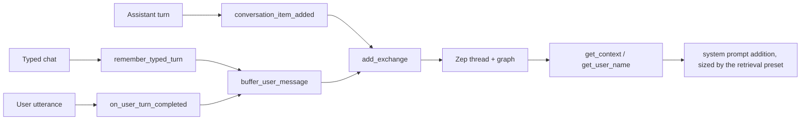
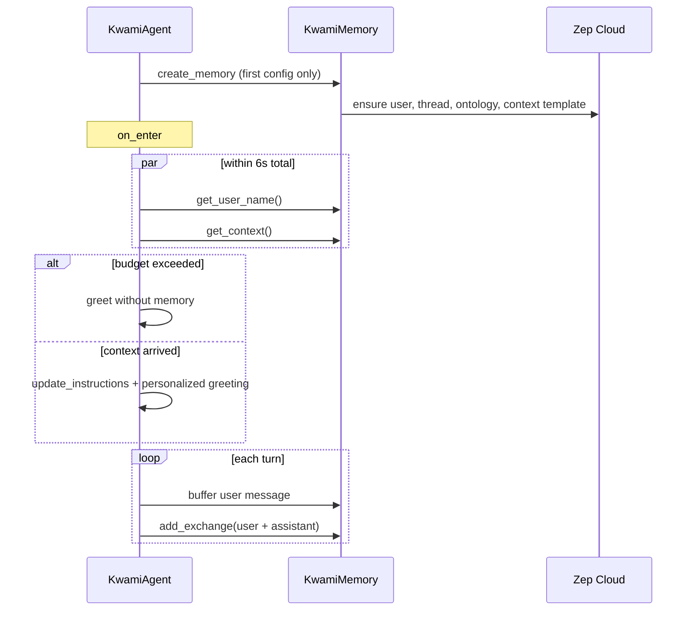
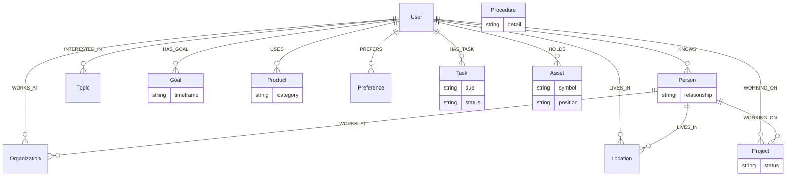

# Persistent memory

Each Kwami can keep independent, long-lived memory on
[Zep Cloud](https://www.getzep.com/). Memory is an enhancement, not a
requirement: if `ZEP_API_KEY` is unset, or Zep is slow, the agent still
greets and talks.

Enable it by setting `ZEP_API_KEY`. `Settings.memory_enabled` is true exactly
when that key is present.

## What is stored

| Store | Contents |
| --- | --- |
| Thread | User and assistant turns, batched as one `add_messages` call |
| Knowledge graph | Facts extracted from user turns, with temporal validity |
| Custom ontology | Person, Project, Product, Goal, Procedure plus constrained edges |

Assistant text is sent with the user turn so Zep has context for extraction,
but `ignore_roles=["assistant"]` keeps the assistant from becoming a graph
entity.

### What reaches the graph

Every turn stays in the thread, but only lasting knowledge is extracted.
`memory/gate.py` decides per exchange; a turn it rejects is sent with
`ignore_roles=["user", "assistant"]`, which keeps it in history without
extraction.

| Turn | Graph |
| --- | --- |
| The assistant says it did not understand (noise, half sentences) | No |
| The assistant acted through a tool that is not passive (open, search, send…) | No, unless the user said something lasting in it ("from now on", "I prefer", "my sister…") |
| Anything else: who the user is, people, projects, routines, decisions | Yes |

Passive tools (`recall_memories`, `get_memory_status`, `get_current_time`,
`get_kwami_info`, `read_user_profile`, `remember_about_user`) do not make a
turn an errand. The tools of a turn come from `function_tools_executed` and the
function calls already on the current speech.

Two more writes:

- **Typed chat.** Text sent from the app goes through `generate_reply(user_input=…)`,
  which skips `on_user_turn_completed`, so `dispatch` hands it to
  `remember_typed_turn` and it is buffered like speech.
- **Work journal.** Each finished piece of work leaves one line through
  `add_work_done` (`graph.add`, type `text`), with the assistant as the one who
  did it: "Jarvis did a piece of work for Ana on 2026-11-16: … Result: …"
  (Spanish when the kwami speaks Spanish; the result is capped at 300
  characters). It is written once, when the result is delivered: in a call
  (`brain/bridge.py`, done work only) or at the next greeting (owed results).

Searches, shopping and research are not written as facts: they are errands.

## Retrieval presets

The panel's preset (`maxContextMessages`, sent as 4 / 10 / 16) picks a budget
in `memory/context.py`:

| Preset | Memory section | Facts / entities from the template | Last-conversation messages |
| --- | --- | --- | --- |
| lean | 1,500 chars | 10 / 5 | 4 |
| balanced | 3,000 chars | 20 / 10 | 10 |
| rich | 6,000 chars | 40 / 20 | 16 |

`minFactRelevance` is applied to the facts of the fallback path (the
cross-encoder's `relevance`). Context templates are shared, one per budget
(`kwami-context-v2-e{edges}-n{entities}`), rather than one per user.

## Continuity between sessions

Every session is a new Zep thread, empty when the greeting is prepared, and
Zep's context for an empty thread has nothing to be relevant to. So:

- `load_last_conversation` finds the most recent earlier thread with anything
  in it (empty reconnect threads are skipped, up to 4) and reads its last
  `maxContextMessages` messages.
- Until this session has an exchange of its own, `get_context` asks Zep for
  context relative to *that* thread, and the prompt gets a short "How your last
  conversation ended" section (at most a third of the budget, most recent lines
  kept). The greeting sees a returning user.
- After the first exchange, and every 3rd after it, the memory block is read
  again for the current thread. On the standard pipeline the instructions are
  updated when the block changed. Realtime and hybrid models are left alone:
  updating their instructions mid-session resends the whole prompt as a turn
  on the Gemini API, so they recall through `recall_memories`.

## Identity

- Zep `user_id` = `kwami_id` from the config message (or telephony bootstrap)
- Typical shape: `kwami_<supabaseUserId>_<kwamiId>`
- Thread id is minted per conversation (`session_{user}_{uuid4}`) unless the
  config supplies `session_id`

Reusing the same `user_id` across config updates is required for recall. A
previous bug created a new `AsyncZep` and a new thread on every `config`
message, so facts were written and never found.

`handle_full_config` therefore **reuses** the live `KwamiMemory` when the new
config targets the same Zep user, and only copies retrieval knobs
(`max_context_messages`, `include_facts`, `min_fact_relevance`). A different
user id creates a new client; the old one is closed by `SessionState`.

## Session timeline

Budgets (see `constants.Timeouts`):

| Budget | Value | Why |
| --- | --- | --- |
| `ZEP_REQUEST` | 8s | Zep's SDK default is 60s per call |
| `MEMORY_CONTEXT` | 6s | `get_user_name` + `get_context` together, before greeting |
| Greeting fallback | immediate | Product is a voice; silence is worse than a generic hello |

`get_user_name` and `get_context` run concurrently. The greeting reuses the
cached context so it does not pay a second round trip.

## Ontology

Custom types extend Zep defaults (User, Assistant, Preference, Location,
Event, Object, Topic, Organization, Document). Edges carry explicit
source **and** target constraints so the graph does not grow User-centric
orphans.

`set_ontology` replaces the user's ontology, so it is applied once per
version: the agent stamps `kwami_ontology: "<version>"` on the user's Zep
metadata after applying the defaults, skips stamped users, and never touches a
user marked `"custom"` (an ontology set from the memory panel). Bump
`ONTOLOGY_VERSION` in `memory/manager.py` when the default types change.

The user's name is kept on their Zep record (`first_name`) once learned, so Zep
names the user's own node after it and the next session reads it without a
graph search. The app does not send the name, so it is learned when the user
says it ("me llamo Ana", "soy Ana", "my name is Ana", capitalised):
`gate.stated_name` reads it and `set_user_name` updates the record, which also
renames a node Zep already created.

To measure what conversations leave in the graph without voice, run
`scripts/memory_lab/run.py` (see its docstring): it writes the fixtures in
`scripts/memory_lab/fixtures/` to two throwaway Zep users, one the old way and
one through `KwamiMemory`, counts junk facts and nodes, asks questions, and
deletes the users.

## Agent tools

| Tool | Purpose |
| --- | --- |
| `remember_fact` | Write an explicit fact into the graph |
| `recall_memories` | Search threads / graph for a topic |
| `get_memory_status` | Initialized?, user id, cached name |

Search-derived facts are written in the background so a Zep hiccup does not
block the spoken answer.

## Billing

Zep retrieval is metered only when it returned content. Empty or failed
lookups do not increment the usage tracker. See [Billing](./billing.md).

## Failure modes

| Failure | Behaviour |
| --- | --- |
| No `ZEP_API_KEY` | Memory stays disabled; no tools talk to Zep |
| Init / ontology error | Logged; session continues without memory |
| Context timeout | Greeting without personalization |
| Write error mid-session | Logged; conversation continues |
| Config targets a new user | New client; old client closed |
| Config targets same user | Live client reused |
