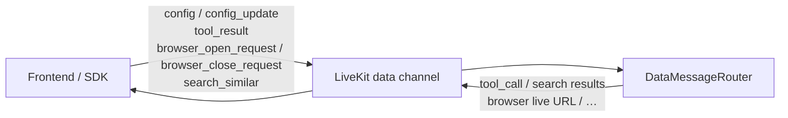
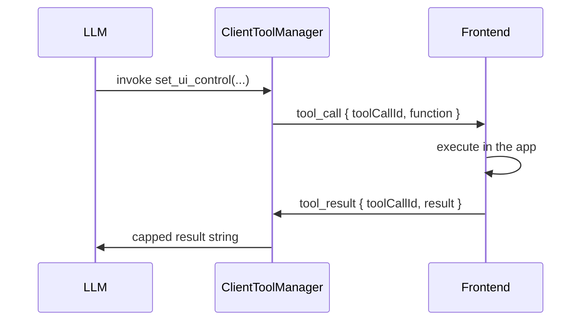

# Data-channel protocol

The frontend and the agent share a LiveKit room. Audio is the voice path.
Control, configuration, tool calls, and UI payloads travel on the **data
channel** as UTF-8 JSON objects with a `type` field.

Malformed packets are discarded. `decode_data_message` never raises: bad UTF-8,
bad JSON, and non-object payloads return `None` so a hostile or buggy client
cannot take down the handler for the rest of the session.



Packet size is capped at **14 000 bytes** (`MAX_DATA_PACKET_BYTES`) so the
publisher stays under LiveKit's hard limit after the SDK envelope. Oversized
search payloads are trimmed in stages (prose first, images last).

## Inbound messages (frontend → agent)

Routed by `DataMessageRouter` in `runtime/dispatch.py`. Config work is spawned
through `SessionState.spawn` and serialized through `run_serialized`.

### `config`

Full identity and pipeline. Replaces the placeholder agent. See
[Configuration](./configuration.md) for the field catalogue.

```json
{
  "type": "config",
  "kwamiId": "kwami_<authUserId>_<kwamiId>",
  "kwamiName": "Ada",
  "timezone": "Europe/Madrid",
  "locale": "en-GB",
  "soul": {
    "name": "Ada",
    "personality": "A calm research partner",
    "systemPrompt": "",
    "traits": ["curious"],
    "language": "en",
    "conversationStyle": "friendly",
    "responseLength": "medium",
    "emotionalTone": "warm",
    "emotionalTraits": { "empathy": 40, "curiosity": 25 }
  },
  "voice": {
    "type": "stt-llm-tts",
    "stt": { "provider": "deepgram", "model": "nova-2", "language": "en" },
    "llm": { "provider": "openai", "model": "gpt-4o-mini", "temperature": 0.7, "maxTokens": 1024 },
    "tts": { "provider": "openai", "model": "tts-1", "voice": "nova", "speed": 1.0 },
    "realtime": { "provider": "openai", "model": "gpt-4o-realtime-preview", "voice": "alloy" }
  },
  "memory": {
    "enabled": true,
    "maxContextMessages": 10,
    "includeFacts": true,
    "minFactRelevance": 0.5
  },
  "tools": [
    {
      "name": "set_ui_control",
      "description": "Change a workspace control",
      "parameters": { "type": "object", "properties": {} }
    }
  ]
}
```

**`timezone`** is an IANA zone (`Europe/Madrid`). Optional, and also accepted
as `timeZone` or `tz`. Without it `get_current_time` falls back to the LiveKit
participant's `timezone` attribute, and then to UTC — labelled as UTC, because
answering in the container's clock as though it were the user's is how that tool
was wrong before.

**`locale`** is a BCP-47 tag for date and number formatting, distinct from
`soul.language`, which decides what the model *writes*: someone can want Spanish
replies with UK date formatting.

**`soul.language`** now reaches the system prompt. It was parsed and settable
for several releases and read by nothing, so an agent configured for Spanish
transcribed and spoke Spanish while writing its replies in English.

`soul` still accepts the legacy key `persona`. CamelCase and snake_case keys
are both accepted (`systemPrompt` / `system_prompt`, …).

**Pipeline selection.** The field above is `voice.type`, which is what the
frontend SDK's `VoicePipelineConfig` actually carries. The agent reads
`type`, `pipelineType`, `pipeline_type` and `pipeline`, and accepts
`stt-llm-tts`, `standard`, `normal`, `classic` and `hybrid` for the STT → LLM →
TTS chain, or `realtime`, `real-time`, `speech-to-speech` and `s2s` for the
single speech-to-speech model. `hybrid` is in the SDK's union, has no
implementation here, and resolves to the standard pipeline with a warning.

This list is long because it was once short. The agent read only `pipelineType`
with the values `standard` / `realtime` — two spellings no client has ever
sent — so selecting the realtime pipeline in the app silently built an
STT+LLM+TTS agent, and every `realtime.*` setting below was parsed into fields
that branch never reads. An unrecognised value is rejected rather than treated
as `standard`, so a typo cannot quietly hand the user the wrong pipeline.

The first `config` of a session **does** greet. Later full configs skip the
greeting if one was already delivered.

**`greeting`** (optional boolean). `false` declines the greeting for the whole
session: the default greeting is generic ("Hey there! I'm {name}..."), wrong for
a character whose caller wrote its own system prompt and who volunteers nothing.
Any other value, or omitting it, keeps the behaviour above.

### `config_update`

Partial update. `updateType` selects the branch.

Among the listening settings, `enhancements.thinkingSound` (boolean, off by
default) plays a soft keyboard clip while the agent is `thinking`, on a second
audio track named `background_audio` that is only published the first time it
plays. Clients must treat that track as background, not as the agent's voice
(SDK: kwami-labs/kwami#152).

| `updateType` | Effect |
| --- | --- |
| `voice` | Listening settings (`enhancements`, `vad`) are applied to the session first, on either pipeline and without a rebuild; a payload of only those stops there. Then dispatches on the live pipeline. A pipeline switch rebuilds; on `realtime`, voice and temperature go over the open socket and provider/model rebuild; otherwise TTS/STT options, with a rebuild on a provider change or a speed change the provider cannot apply live |
| `pipeline` | Switches between `standard` and `realtime`, carrying any realtime fields in the same payload |
| `llm` | Recreates the agent. On the `realtime` pipeline this retargets the **realtime** model rather than building a standard pipeline underneath the session |
| `soul` / `persona` | Rebuilds instructions in place, preserves cached memory context |
| `memory` | Updates retrieval knobs on the live Zep client |
| `tools` | Re-registers client tools **alongside** the built-ins, capped (see below) |
| `brain` | Configures the brain bridge (`parse_brain`); ignored when the session has no bridge |

Voice, speed and temperature on the realtime pipeline are pushed with
`RealtimeModel.update_options` rather than by rebuilding, because a rebuild
drops the socket and re-greets, which the user hears. Anything that decides
which object was constructed — provider, model, pipeline type — cannot be
pushed and rebuilds. Every rebuild carries the conversation, the live cloud
browser and any in-flight client-tool calls onto the new agent.

```json
{
  "type": "config_update",
  "updateType": "llm",
  "config": {
    "provider": "anthropic",
    "model": "claude-3-5-sonnet-latest",
    "temperature": 0.5
  }
}
```

For `tools`, `config` is the tool-definition list itself (not wrapped).

**Tool budget.** The model is sent the agent's built-ins plus every registered
client tool. OpenAI rejects a request carrying more than 128 tools outright, so
the combined list is trimmed to fit rather than sent over: built-ins are kept in
preference to client tools, and anything dropped is logged at `error` with its
name. A warning fires from 85% of the limit. Only the built-ins the session
actually offers count: those withheld for a missing credential, a locked voice
or searches given to the brain leave their place to client tools. `kwami-app`
registers about a hundred client tools against 47 built-ins, so the trim is
routine; it reports the outcome in [`tool_inventory`](#tool_inventory).

**Definitions that are refused.** A client tool is skipped, with a warning, when
its name is not one every provider accepts (`[A-Za-z_][A-Za-z0-9_-]{0,63}`) or
its `parameters` are not an object schema with a schema per property. Either
would make the provider reject every request of the session, not just lose one
tool. The SDK's shorthand -- a bare map of property name to schema -- is accepted
and wrapped as `{"type": "object", "properties": ..., "required": []}`.

### `tool_result`

Completes a pending client-tool future. Results are capped at 4 000 characters
before they enter the LLM context.

```json
{
  "type": "tool_result",
  "toolCallId": "550e8400-e29b-41d4-a716-446655440000",
  "result": "ok",
  "error": null
}
```

If `error` is set, the model receives `Error from client: …`.

### `browser_open_request`

Opens a URL in the live browser panel — published when the user picks a search
result rather than asking for it out loud.

```json
{ "type": "browser_open_request", "url": "https://example.com/article" }
```

Routed through the same path as the agent's own `navigate_to`, so it inherits
both of that path's checks: the URL is validated (non-HTTP schemes, loopback,
private ranges, link-local metadata and DNS that resolves to any of them are
refused), and a browser is never started for a session with no `kwami_id`,
because a shared profile would carry one user's cookies to the next. The
frontend is not treated as a trusted source of URLs: the same envelope can
carry a link the model was reading on a page a moment earlier.

A refusal is logged at `warning`. There is no model turn to return a sentence
to on this path, so nothing else would make it visible.

### `browser_close_request`

User closed the live browser panel. Closes the session-owned
`CloudBrowserSession` so per-minute billing stops.

```json
{ "type": "browser_close_request" }
```

### `text`

A typed message (the SDK's `sendText`). Whatever is being said is interrupted,
then the text (trimmed, capped at 4 000 characters) is answered as if spoken.

```json
{ "type": "text", "text": "What's on my calendar?" }
```

### `interrupt`

The app's Interrupt button: stops the agent's current speech. No other fields.

```json
{ "type": "interrupt" }
```

### `search_similar`

Runs `web_search` with `search_for_products=True` for
`similar to {title} buy`. The title is truncated to 80 characters.

```json
{ "type": "search_similar", "title": "Canvas tote bag" }
```

## Outbound messages (agent → frontend)

Published via `room.local_participant.publish_data` or
`LiveKitRoomPublisher`.

### `tool_call`

A client-side tool the LLM invoked. The frontend must reply with `tool_result`
using the same `toolCallId` within **30 seconds**.

```json
{
  "type": "tool_call",
  "toolCallId": "550e8400-e29b-41d4-a716-446655440000",
  "function": {
    "name": "set_ui_control",
    "arguments": "{\"domain\":\"theme\",\"control\":\"mode\",\"value\":\"dark\"}"
  }
}
```

`arguments` is a JSON **string**, not an object.



Pending futures survive agent swaps. `SessionState.update_agent` moves
unresolved calls onto the new `ClientToolManager`.

#### Over LiveKit RPC

An app that registers the RPC method `kwami.client_tool` and sets the
participant attribute `kwami.client_tools` to `rpc` gets tool calls as RPCs
instead, addressed to it alone:

```json
{ "toolCallId": "550e8400-...", "name": "set_ui_control", "arguments": { "domain": "theme" } }
```

Here `arguments` is an **object**. The RPC's return value is the result; an
error the handler throws (an RPC application error) reaches the model as
`Error from client: <message>`, and the same 30-second deadline applies. If the
RPC is refused for reasons that are not the tool's (`UNSUPPORTED_METHOD`,
`UNSUPPORTED_SERVER`, `UNSUPPORTED_VERSION`, `REQUEST_PAYLOAD_TOO_LARGE`), the
call is retried over the data channel above. An app without the attribute never
sees an RPC.

### `transcript`

One finished turn's text, sent from `conversation_item_added` so the browser can
render the transcript (and, in a game, check a guess against a phrase there: the
worker never decides who won). `lk.transcription` carries interim fragments
without a trusted role, so this is the explicit frame. Only non-empty user and
assistant turns are sent.

```json
{ "type": "transcript", "role": "player", "text": "Is it a banana?" }
```

| `role` | Turn |
| --- | --- |
| `player` | The user's |
| `kwami` | The agent's |

### `metrics`

How long one reply kept the user waiting, per stage, in milliseconds. Sent
once per assistant reply by `runtime/turn_metrics.py`; the SDK passes it to
`VoiceSession.updateLatency`, which feeds the app's Metrics panel.

```json
{
  "type": "metrics",
  "metrics": { "stt": 210, "endOfTurn": 800, "llm": 457, "tts": 250, "overall": 1500 }
}
```

| Field | Framework timing | Measured on |
| --- | --- | --- |
| `stt` | `transcription_delay` | the user's message |
| `endOfTurn` | `end_of_turn_delay` | the user's message |
| `llm` | `llm_node_ttft` | the reply |
| `tts` | `tts_node_ttfb` | the reply |
| `overall` | `e2e_latency` (end of speech to first audio) | the reply |

A stage that did not run is left out rather than sent as `0`: a realtime voice
has no TTS of ours, and the greeting has no user turn behind it. The user's
half belongs to the first reply after it only.

### `tool_inventory`

What the model is offered, sent after the agent enters the room, after every
`tools` update and whenever the search tools are re-gated. The app's Tools
panel shows it; client tools in `dropped` exist in the app but not for the model.

```json
{
  "type": "tool_inventory",
  "limit": 128,
  "total": 128,
  "builtin": ["change_ai_model", "web_search", "..."],
  "client": 96,
  "dropped": ["read_emails", "send_email"]
}
```

| Field | Meaning |
| --- | --- |
| `limit` | The ceiling the list was trimmed to |
| `total` | Tools offered, built-in and client |
| `builtin` | Names of the agent's own tools that are on, sorted |
| `client` | How many of the client's tools made it |
| `dropped` | Client tools left out, in the order the client registered them |

Names only: the client already has the definitions, and the payload has to fit
the 14 KB packet budget.

### Search and browser payloads

Built-in tools also publish structured events so the UI can render cards and a
live browser iframe. Typical `type` values include `search_results`, `remove_result`,
`browser_session` (live view URL), `brain_status` (each task lists in `briefed`
the models whose prompt carried the user's instructions), `brain_instructions`
(`{target: "brain" | <model id>, instructions}`: the user changed them by voice
and the app saves it like a typed change), `voice_fallback` (the voice
engine was swapped after a failure) and `config_request` (no `config` arrived,
so the app is asked to resend it). Exact UI schemas live in the
TypeScript SDK; the agent treats them as JSON objects and trims them to fit
the 14 KB packet budget.

An app that registers the text-stream topic `kwami.message` and sets the
participant attribute `kwami.messages` to `stream` gets any payload over that
budget **whole** instead, as a text stream on that topic addressed to it alone,
with the same JSON as the data packet would carry. If the stream cannot be
sent, or no participant advertises it, the payload is trimmed as above.

## Telephony bootstrap

Phone sessions have no frontend to send `config`. The worker resolves
`kwami_id` from job metadata, SIP participant metadata, or participant
attributes, then fetches:

```
GET {KWAMI_RUNTIME_API_URL or KWAMI_API_URL}/internal/kwamis/{kwami_id}/runtime
Header: X-Kwami-API-Key: {KWAMI_API_KEY}
```

`KWAMI_RUNTIME_API_URL` is optional; unset, the fetch goes to `KWAMI_API_URL`.

The JSON body is the same shape as a `config` message and is applied through
`handle_full_config`.

## Metrics (not data channel)

Usage is not a data-channel message. The session listens for
`metrics_collected` on `AgentSession` and `route_metrics` dispatches:

| Metric `type` | Tracker method |
| --- | --- |
| `llm_metrics` | `on_llm_metrics` |
| `stt_metrics` | `on_stt_metrics` |
| `tts_metrics` | `on_tts_metrics` |
| `realtime_model_metrics` | `on_realtime_metrics` |

See [Billing](./billing.md).
